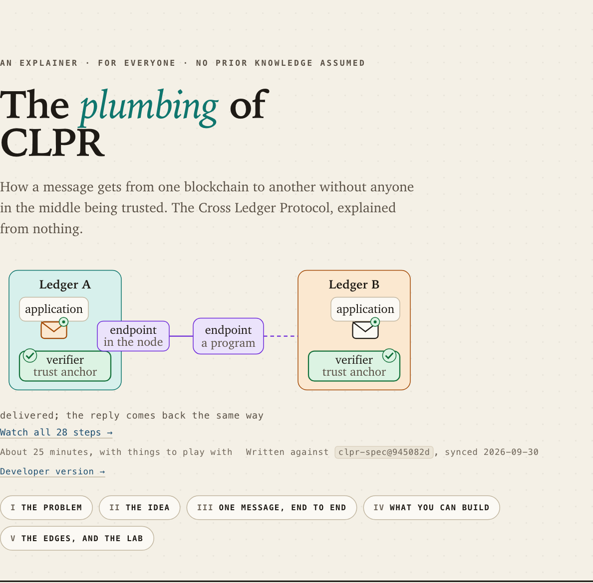
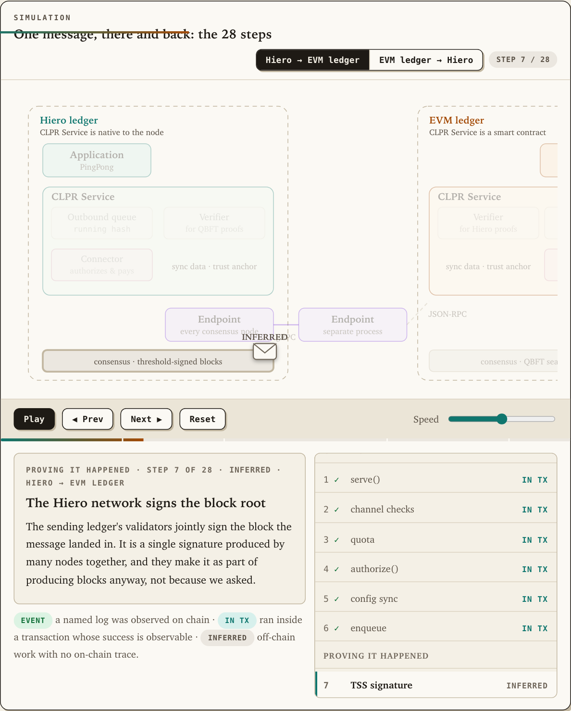
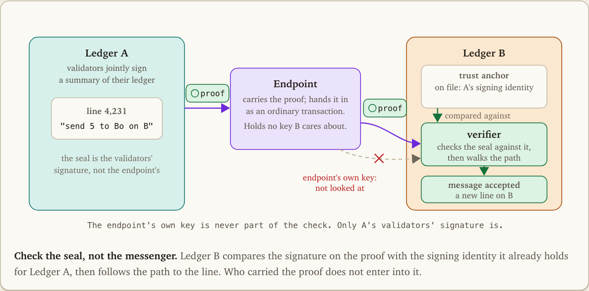
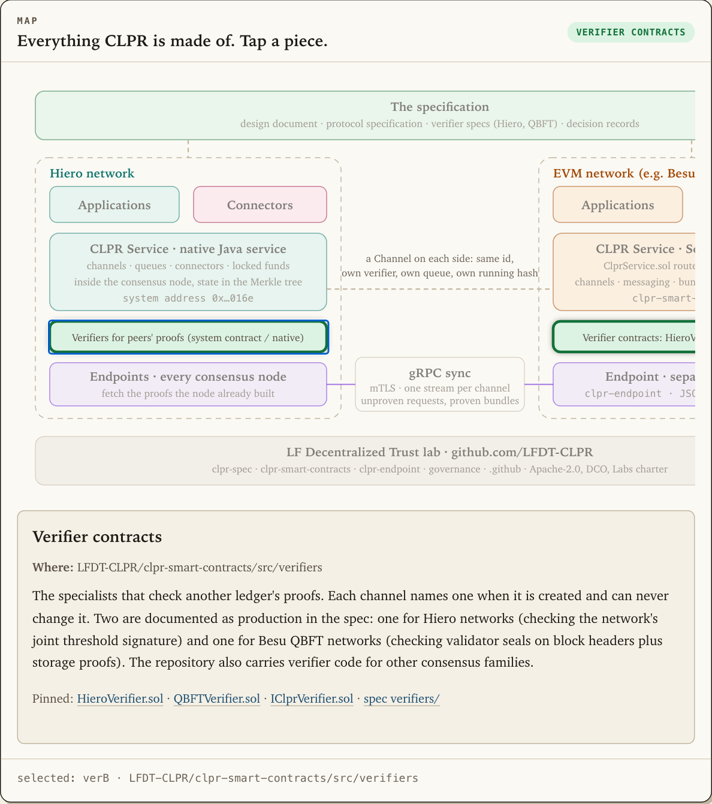
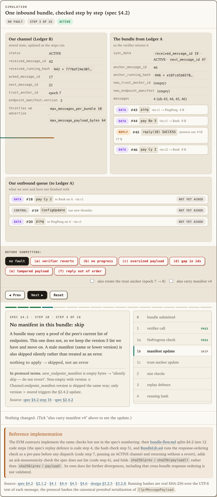

# The plumbing of CLPR

Two one-page explainers of **CLPR** ("Clipper"), the bridgeless Cross Ledger Protocol developed
as an [LF Decentralized Trust](https://www.lfdecentralizedtrust.org/) lab at
[github.com/LFDT-CLPR](https://github.com/LFDT-CLPR). Both take a reader who knows nothing about
CLPR to a working understanding of the whole system, with the journey of one message as the
centrepiece and the specification, the smart contracts, the endpoint and the lab's governance all
covered. Each page opens with a twelve-second wordless loop of that journey, then explains it
with forty-nine captioned figures and fourteen interactive simulations. Every claim is written
against pinned commits of the upstream repositories, and the build fails if the pages and the
pins disagree.

The explainer is part of the CLPR website: this directory is built into the site's `/plumbing/` by the
website's `pnpm build` (`embed.mjs` runs Astro with `BASE_PATH=/plumbing/`); see
[docs/deployment.md](docs/deployment.md). Every command below runs from `explainer/`.

| Page | For | Covers |
|---|---|---|
| **`/`** | Anyone. No prior knowledge assumed. | What a ledger is, why ledgers cannot see each other, why bridges fail, proof instead of trust, the cast, the 28-step round trip in both directions, the running-hash chain, who pays, what can go wrong, channels, couriers, verifiers, the six roles, a tappable map of every piece of software, adding a ledger, limits, how the spec changes, the LFDT lab |
| **`/developers/`** | Developers. No prior knowledge of CLPR; comfort with ledgers, hashes and contracts. | The same arc at full depth: trust model, four layers, identity and throttles, channels (commit-reveal, lifecycle), endpoints and manifests, the sync protocol, queue and running hash, bundles and progress, the bundle verification algorithm with fault injection, response ordering, connectors and slashing, verifiers and trust-anchor rotation, the application API, roles, recovery, security, the reference implementations and their divergences, the ADRs, governance, glossary |

<p align="center"> </p>
<p align="center"> </p>
<p align="center"></p>

## What makes it trustworthy

- **Pinned, not linked to `main`.** [`src/data/sources.json`](src/data/sources.json) records the
  exact commit of each of the five LFDT-CLPR repositories the text was checked against. Every
  upstream link embeds that commit; both pages show the table; `pnpm run check` fails on any
  branch link or mismatch.
- **Labelled claims.** The pages distinguish what the specification says, what the reference
  Solidity and Java code actually does (including its documented divergences), and what the
  specification itself marks as unresolved. The journey marks each step as observable on chain,
  observable through a transaction, or inferred.
- **A figure for every mechanism.** Forty-nine static drawings, one per idea, each with a bold
  lead phrase, a caption and a source line pinned to the upstream commit; see
  [docs/figures.md](docs/figures.md).
- **Real numbers where it is cheap.** The hash-chain and bundle-verification simulations compute
  real SHA-256; the registration simulation computes real Keccak-256 with a self-test.
- **Neutral, donation-ready.** Apache-2.0 code, CC BY 4.0 prose, DCO-signed commits, no
  branding, no marketing. The explainer says it is part of the CLPR website; where it
  and the repositories disagree, the repositories are right.

## Quick start

```bash
pnpm install
pnpm run dev            # http://localhost:4321
pnpm test               # build + provenance + link checks
pnpm run check:browser  # drives every simulation in Chromium; pnpm exec playwright install chromium once
```

Astro 7 + MDX, no UI framework, no runtime dependencies, the CLPR website's fonts self-hosted. Content lives in
`src/content/*.mdx`; figures in `src/components/diagrams/<page>/`; simulations in
`src/components/sims/`; the section and act registry, the journey steps and the provenance
manifest in `src/data/`.

## Keeping it current

```bash
pnpm run sync:fetch                     # fetch upstream, report drift, write patches to .upstream/
# review and update the affected sections (docs/content-map.md says which)
pnpm run sync:pin                       # move the pins to the reviewed commits
pnpm test && pnpm exec kse check-anchors
```

The full procedure is the [`clpr-sync` skill](.claude/skills/clpr-sync/SKILL.md), which Claude
can run end to end (fetch, read the diffs, update both pages and the simulations, re-pin, check,
look, audit, record, commit). Two report-only skills go with it: [`clpr-drift`](.claude/skills/clpr-drift/SKILL.md)
says what moved upstream and what it touches; [`clpr-audit`](.claude/skills/clpr-audit/SKILL.md) checks every
statement against the passage it cites at the pinned commits. A weekly [workflow](.github/workflows/upstream-watch.yml) opens an issue
when a pinned repository has moved. See [docs/syncing.md](docs/syncing.md).

## Building against other commits

The pages are written against the commits in `src/data/sources.json`. To see whether the text still holds at other commits
(or to publish a version for one), check them out in `.upstream/` and re-run the gates; the generic procedure is in the engine's
`building-at-any-commit` guide (`node_modules/knowledge-site-engine/docs/building-at-any-commit.md` after `pnpm install`):

```bash
pnpm run sync:fetch                           # clone or update every source into .upstream/
git -C .upstream/clpr-spec checkout <sha>    # any commit, branch or tag, per source
pnpm run sync:pin                             # write what is checked out into src/data/sources.json
pnpm run build && pnpm run check && pnpm run check:anchors && pnpm exec kse check-code-refs
git checkout src/data/sources.json           # restore the reviewed pins unless you mean to move them
```

Failures in `check:anchors` or `check-code-refs` are the citations that no longer match at those commits.

## Deploy

Netlify: import the repository; [`netlify.toml`](netlify.toml) does the rest. GitHub Pages:
enable *Pages → Source: GitHub Actions*; [`pages.yml`](.github/workflows/pages.yml) builds under
`/<repo>/`. See [docs/deployment.md](docs/deployment.md).

## Documentation

Everything about the build, the content model, the writing rules, the figures, the simulations,
provenance, syncing, deployment, testing and the decisions behind them is in
[`docs/`](docs/README.md).
[`CLAUDE.md`](CLAUDE.md) is the short rulebook for AI-assisted edits; [`CHANGELOG.md`](CHANGELOG.md)
records every sync with the upstream commit range it was reviewed against.

## Contributing and license

Pull requests welcome; every commit needs a DCO sign-off (`git commit -s`). See
[CONTRIBUTING.md](CONTRIBUTING.md). Code is [Apache-2.0](LICENSE); prose is
[CC BY 4.0](https://creativecommons.org/licenses/by/4.0/).

## Writing rules

The engine carries the rules this site is written and audited by: provenance-free prose, exact scope for every claim, a figure for every concept, and cited fact sheets before writing. See the engine's `docs/authoring.md` (known failure classes and the research-first workflow) and run `pnpm exec kse audit-input` for the audit inputs and judge brief.
